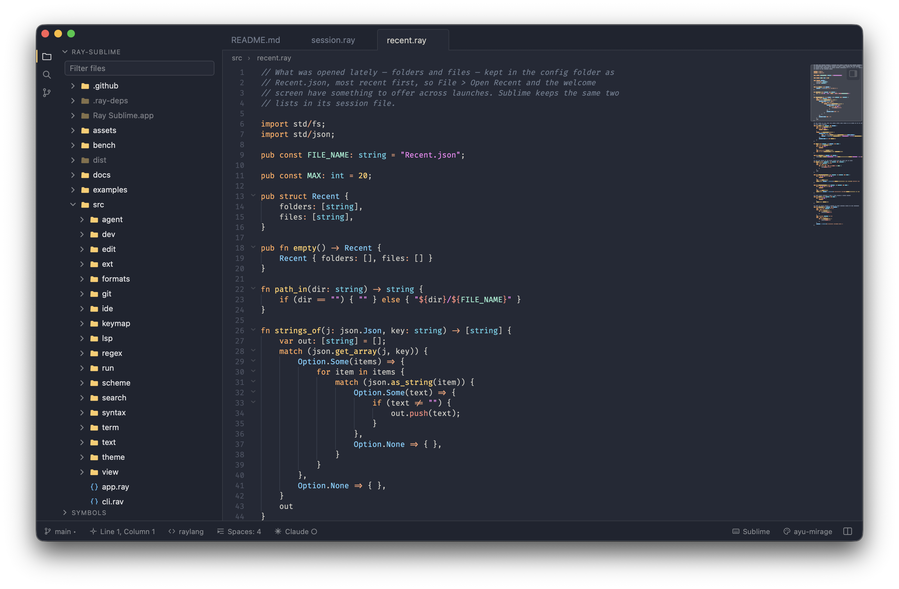
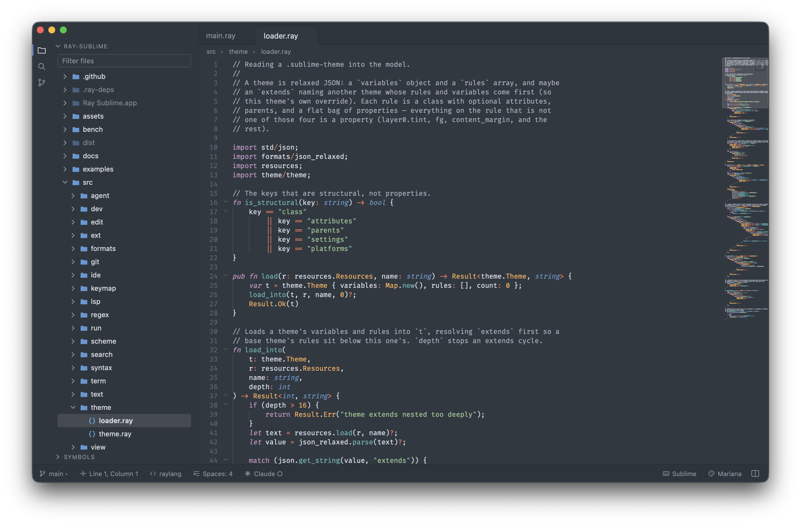
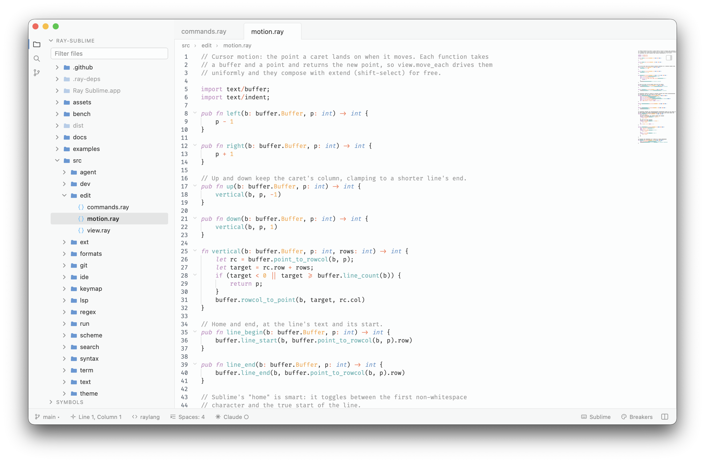
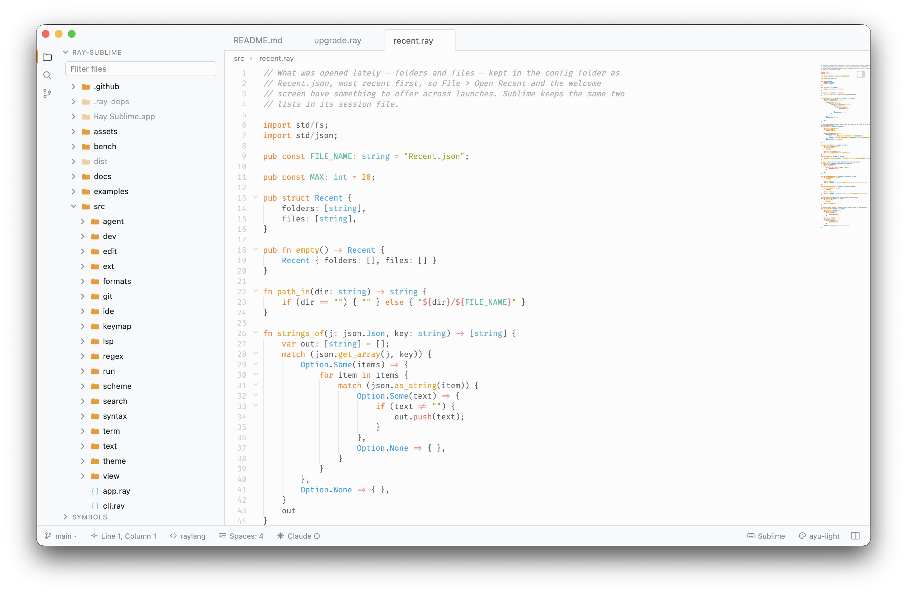

<p align="center">
  
</p>

<h1 align="center">Ray Sublime</h1>

<p align="center"><b>A code editor that speaks Sublime Text's language, written in <a href="https://raylang.dev">raylang</a>.</b></p>

<p align="center">
  <a href="https://github.com/ray-language/ray-sublime-releases/releases/latest"></a>
  
  
  
</p>

<p align="center">
  <a href="#install">Install</a> ·
  <a href="#sublimes-ecosystem-read-natively">Features</a> ·
  <a href="#updates">Updates</a> ·
  <a href="#versions">Versions</a>
</p>

<p align="center">
  
</p>

Ray Sublime reads what Sublime Text 4 reads: `.sublime-syntax` grammars, color schemes, themes,
keymaps, snippets and settings, straight from a Sublime installation or from a package you drop
in. On top of that it brings what a 2026 editor is expected to have: language servers, an
integrated terminal, Git, Claude Code and other AI agents with MCP tools, dev containers, and an
extension model of its own.

This repository holds the **published builds** and the files the editor downloads to update
itself. The source lives in a private repository.

## Install

**macOS** (Apple silicon) and **Linux** (x86_64, aarch64):

```sh
curl -fsSL https://raw.githubusercontent.com/ray-language/ray-sublime-releases/main/install.sh | sh
```

**Windows** (x86_64, ARM64), in PowerShell:

```powershell
irm https://raw.githubusercontent.com/ray-language/ray-sublime-releases/main/install.ps1 | iex
```

The script downloads the build for your machine, checks it against the signed release manifest,
unpacks it and registers the app (Launchpad, the desktop menu or the Start Menu).

| Platform | Installed to | Launch |
|---|---|---|
| macOS | `/Applications/Ray Sublime.app` (or `~/Applications` when `/Applications` is not writable) | Launchpad, or `open -a "Ray Sublime"` |
| Linux | `~/.local/opt/ray-sublime`, a desktop entry, and `~/.local/bin/ray-sublime` | the applications menu, or `ray-sublime .` |
| Windows | `%LOCALAPPDATA%\Programs\ray-sublime`, a Start Menu shortcut, and the folder on your `PATH` | the Start Menu, or `ray-sublime .` |

`RAY_SUBLIME_VERSION=0.1.17` installs that version instead of the latest; `RAY_SUBLIME_DIR=<folder>`
installs it somewhere else. To install by hand, download the zip for your platform from the
[latest release](https://github.com/ray-language/ray-sublime-releases/releases/latest), unzip it
and run the `install.sh` / `install.ps1` inside (Linux, Windows) or drag `Ray Sublime.app` to
Applications (macOS). The macOS app is signed with a Developer ID and notarized by Apple, so it
opens without Gatekeeper asking.

## Sublime's ecosystem, read natively

- `.sublime-syntax` grammars, run by an Oniguruma-compatible regex engine of its own.
- `.sublime-color-scheme` and `.tmTheme` schemes, `.sublime-theme` themes (Sublime's Default,
  Default Dark and Adaptive included).
- `.sublime-keymap` with chords and arguments, plus the `vscode` and `vim` presets;
  `.sublime-snippet`; `.sublime-settings` stacked the way Sublime stacks them.
- `.sublime-project` with per-folder settings and patterns, `.sublime-package` zips, and Package
  Control's installed packages.
- On macOS, the packages of an installed Sublime Text are picked up as they are; elsewhere the
  carried definitions cover the common languages.

<p align="center">
  
  
</p>
<p align="center"><sub>Sublime's own Mariana and Breakers schemes with the Adaptive theme.</sub></p>

## The editing you expect

- **Navigation**: Goto Anything (`⌘P`), Goto Symbol (`⌘R`), Goto Line, Goto Definition and
  References, the command palette (`⇧⌘P`), breadcrumbs and sticky scroll.
- **Editing**: multiple cursors, column selection, find and replace with regex, find in files,
  snippets, auto-complete, bracket matching, folding, bookmarks, spell checking, a vim keymap.
- **The file**: indentation detection, `.editorconfig`, trim-on-save, line endings and encodings
  (Windows-1252, Shift-JIS, GBK, Big5, KOI8-R and the other legacy ones included).
- **The window**: minimap, rulers, word wrap, Distraction Free mode, tabs you can pin, splits and
  layouts, panels docked on all four sides, sessions and projects, multiple windows, and hot exit
  with untitled buffers restored.

<p align="center">
  
</p>

## And what Sublime does not have

- **Claude Code as an IDE.** A CLAUDE CODE panel runs the `claude` CLI connected to the editor.
  It sees your selection and open files and gets the language servers' diagnostics. Each change
  it proposes appears as a diff in the file's own tab, and you accept, reject or revert it chunk
  by chunk. The files it changed are marked in the sidebar and on their tabs. Files and images
  dropped on the panel are handed to it, and the conversation resumes when the window comes back.
- **Language servers.** A built-in LSP client finds the servers on your login shell's `PATH`
  (raylang, TypeScript, Python, Rust, Go, C/C++, JSON, CSS, HTML, YAML, TOML, shell, Lua,
  Markdown…). It gives completion, hover, diagnostics, rename, formatting, code actions and
  workspace edits.
- **Integrated terminal** (macOS and Linux). File paths it prints are links, and a file dropped
  on it from the sidebar or Finder is typed in.
- **Git.** Status, diff marks in the margin, blame, stage, commit, stash and branches.
- **AI agents.** A chat panel for Anthropic, OpenAI, Gemini, Ollama or any OpenAI-compatible
  endpoint, with keys in the system keychain. It reads the project, proposes edits you review as
  diffs, runs commands under an allow list, and uses the tools of your **MCP** servers.
- **Dev containers.** `.devcontainer/devcontainer.json` is started, stopped and rebuilt from the
  editor. The terminal, the agent's commands and the language servers run inside it.
- **Extensions.** Each has a manifest, an optional service speaking JSON-RPC to the editor, and
  permissions under folder trust. They install from the editor's own index.
- **A `ray-sublime` command** for the terminal: `ray-sublime .` opens the folder you are in.

## Updates

Ray Sublime checks for a newer version once a day, and right away on *Ray Sublime › Check for
Updates…*. It installs an update only when the manifest's Ed25519 signature matches the key built
into the app and the zip's size and SHA-256 match the manifest.

## Versions

### 0.1.18 · 23 November 2026

- **Diff marks in Markdown files.** A `.md` file (or an `.svg`) switched from Preview to its
  source shows the git marks beside the line numbers at once. Before, they appeared only after a
  save or a stage.
- **Dragging the window with no file open.** The middle of the title bar drags the window again
  while the welcome screen is showing.
- Built with raylang 1.27.111, which now names the bundle `Ray Sublime.app` and opens links
  itself.

### 0.1.17 · 20 November 2026

- The Claude Code panel starts `claude` when the app was opened from the Finder or restarted by an
  update. Before, `claude` was not on the app's `PATH` and the panel said the session had ended.
  It now runs with your shell's `PATH`, as the language servers do.

### 0.1.16 · 19 November 2026

- The editor is now **Ray Sublime**: window titles, About, the welcome screen and messages.
- On macOS the app is **Ray Sublime.app**, and the menu bar, Dock and ⌘-Tab show that name. An
  existing `ray-sublime.app` updates in place and keeps its path and terminal command.
- A new icon: the same flat bolt, wider and in honey.

### 0.1.15 · 19 November 2026

- Language servers run with your login shell's `PATH`, so servers installed with npm, nvm, fnm,
  Go or pip work when the app is opened from the Finder or the Dock.
- A language server that stops at once says why in the panel, and how to install it.

Every version, with its notes and zips, is on the [releases
page](https://github.com/ray-language/ray-sublime-releases/releases).

## Platforms

| Platform | Status |
|---|---|
| macOS, Apple silicon | ✓ Native menus, the Sublime installation's packages, terminal, CLI, keychain, signed and notarized app. |
| Linux, x86_64 and aarch64 | ✓ Runs with the system title bar. No Sublime installation is read, so syntaxes and schemes come from extensions and the carried definitions. |
| Windows, x86_64 and ARM64 | ✓ The integrated terminal is not available yet. |
| macOS, Intel | not built yet |

## What each release carries

- `ray-sublime-<version>-<platform>-<arch>.zip`, the app bundle for one platform;
- `update.json`, the manifest naming the newest version and each platform's zip
  with its size and SHA-256;
- `update.json.sig`, the Ed25519 signature of the manifest.

The editor reads `releases/latest/download/update.json` from here. It trusts the
manifest only when it is signed with the key whose public half is baked into
the app, and it checks every zip against the manifest before installing it, so
a copy of these files hosted anywhere else is just as safe to use. The install
scripts do the checksum part of that check too.

Pre-releases are never served as the latest version.
