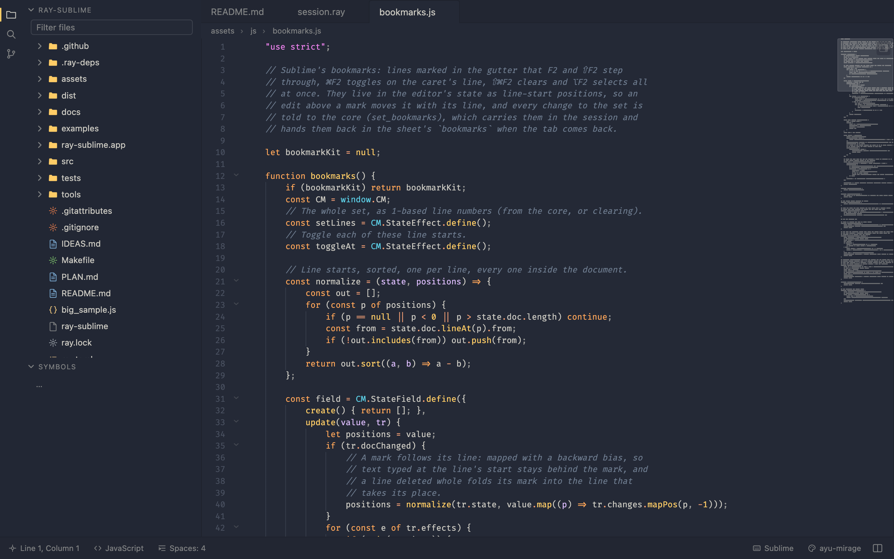
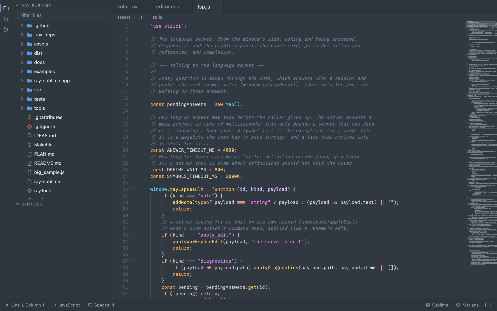
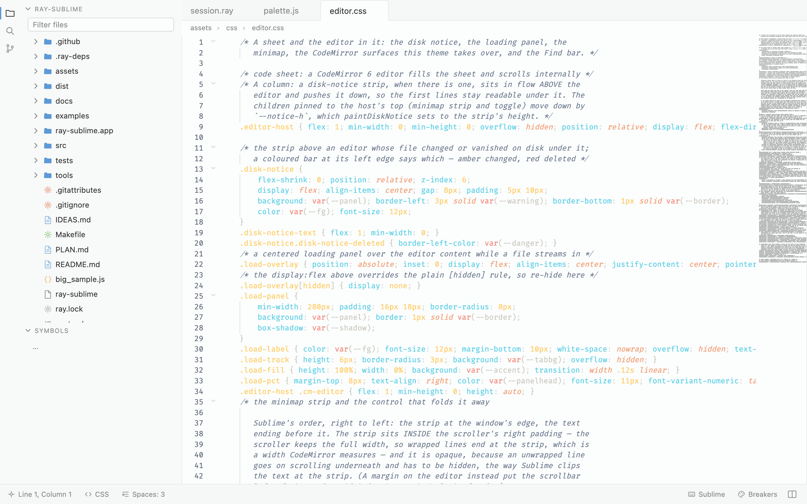

# ray-sublime

**A code editor that speaks Sublime Text's language, written in [raylang](https://raylang.dev).**

ray-sublime reads what Sublime Text 4 reads: `.sublime-syntax` grammars, color
schemes, themes, keymaps, snippets and settings, straight from a Sublime
installation or from a package you drop in. On top of that it brings what a
2026 editor is expected to have: language servers, an integrated terminal, Git,
AI agents with MCP tools, dev containers, and an extension model of its own.

<p align="center">
  
</p>

This repository holds the **published builds** and the files the editor
downloads to update itself. The source lives in a private repository.

## Install

One line, on each platform. The script downloads the build for your machine,
checks it against the signed release manifest, unpacks it and registers the
app (Launchpad, the desktop menu or the Start Menu).

**macOS** (Apple silicon) and **Linux** (x86_64, aarch64):

```sh
curl -fsSL https://raw.githubusercontent.com/ray-language/ray-sublime-releases/main/install.sh | sh
```

**Windows** (x86_64, ARM64), in PowerShell:

```powershell
irm https://raw.githubusercontent.com/ray-language/ray-sublime-releases/main/install.ps1 | iex
```

Where it goes:

| Platform | Installed to | Launch |
|---|---|---|
| macOS | `/Applications/ray-sublime.app` (or `~/Applications` when `/Applications` is not writable) | Launchpad, or `open -a ray-sublime` |
| Linux | `~/.local/opt/ray-sublime`, a desktop entry, and `~/.local/bin/ray-sublime` | the applications menu, or `ray-sublime .` |
| Windows | `%LOCALAPPDATA%\Programs\ray-sublime`, a Start Menu shortcut, and the folder on your `PATH` | the Start Menu, or `ray-sublime .` |

Both scripts take `RAY_SUBLIME_VERSION` to install a given version instead of
the latest, and `RAY_SUBLIME_DIR` to choose where it goes. To install by hand,
download the zip for your platform from the [latest
release](https://github.com/ray-language/ray-sublime-releases/releases/latest),
unzip it and run the `install.sh` / `install.ps1` inside (Linux, Windows) or
drag `ray-sublime.app` to Applications (macOS).

The macOS app is signed with a Developer ID and notarized. Once installed, the
editor keeps itself current: it checks for a newer version once a day and on
*ray-sublime › Check for Updates…*, and installs it only when the manifest's
signature and the zip's checksum are right.

## What you get

**Sublime's ecosystem, read natively.**
- `.sublime-syntax` grammars with an Oniguruma-compatible regex engine of its
  own, `.sublime-color-scheme` and `.tmTheme` schemes, `.sublime-theme` themes
  (Sublime's Default, Default Dark and Adaptive included), `.sublime-keymap`
  with chords, arguments and the `vscode` and `vim` presets, `.sublime-snippet`,
  `.sublime-settings` stacked the way Sublime stacks them, `.sublime-project`
  with per-folder settings and patterns, `.sublime-package` zips, Package
  Control's installed packages.
- On macOS, the packages of an installed Sublime Text are picked up as they
  are; the carried definitions cover the common languages elsewhere.

**The editing you expect.**
- Multiple cursors, column selection, find and replace with regex, find in
  files, Goto Anything (`⌘P`), Goto Symbol (`⌘R`), Goto Line, Goto Definition
  and References, the command palette (`⇧⌘P`).
- Snippets, auto-complete, bracket matching, folding, minimap, breadcrumbs,
  rulers, word wrap, indentation detection, `.editorconfig`, trim-on-save,
  encodings and line endings, bookmarks, spell checking, Distraction Free
  mode, a vim keymap.
- Tabs you can pin, splits and layouts, panels docked on all four sides, hot
  exit with untitled buffers restored, sessions and projects, multiple windows.

**And what Sublime does not have.**
- **Language servers**: a built-in LSP client that finds the servers on your
  `PATH` (raylang, TypeScript, Python, Rust, Go, C/C++, JSON, CSS, HTML,
  YAML, TOML, shell, Lua, Markdown…): completion, hover, diagnostics, rename,
  formatting, code actions, workspace edits.
- **Integrated terminal** (macOS and Linux), **Git** (status, diff, blame,
  stage, commit, stash, branches).
- **AI agents**: a chat panel for Anthropic, OpenAI, Gemini, Ollama or any
  OpenAI-compatible endpoint, with keys in the system keychain; it reads the
  project, proposes edits you review as diffs, runs commands under an allow
  list, and uses the tools of your **MCP** servers.
- **Dev containers**: `.devcontainer/devcontainer.json` started, stopped and
  rebuilt from the editor; the terminal, the agent's commands and the language
  servers run inside.
- **Extensions** with a manifest, an optional service speaking JSON-RPC to the
  editor, permissions and folder trust, installed from the editor's own index.
- A `ray-sublime` command for the terminal, folder trust, and self-update.

<p align="center">
  
</p>

<p align="center">
  
</p>

## Platforms

| | Status |
|---|---|
| macOS (Apple silicon) | Full: native menus, the Sublime installation's packages, terminal, CLI, keychain, signed and notarized app. |
| Linux (x86_64, aarch64) | Runs with the system title bar; no Sublime installation is read, so syntaxes and schemes come from extensions and the carried definitions. |
| Windows (x86_64, ARM64) | Builds are published; the integrated terminal is not available there yet. |

## What each release carries

- `ray-sublime-<version>-<platform>-<arch>.zip`, the app bundle for one platform;
- `update.json`, the manifest naming the newest version and each platform's zip
  with its size and SHA-256;
- `update.json.sig`, the Ed25519 signature of the manifest.

The editor reads `releases/latest/download/update.json` from here. It trusts the
manifest only when it is signed with the key whose public half is baked into
the app, and it checks every zip against the manifest before installing it, so
a copy of these files hosted anywhere else is just as safe to use. The install
scripts do the checksum part of that check too.

Pre-releases are never served as the latest version.
